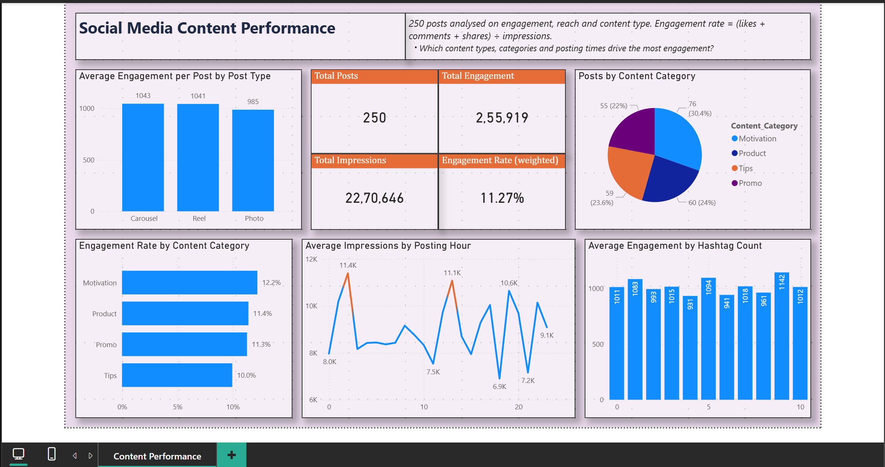

# Social Media Content Performance Analytics


[](screenshots/01_content_performance.png)

*Select the image to view it at full size.*

---

## Project Overview

A Power BI dashboard and Python analysis of 250 social media posts. The project compares engagement, reach and content type to show which kinds of content and posting patterns are associated with the most engagement.

Raw likes or reach can mislead, because a post with many impressions is not necessarily more engaging. This project therefore compares content on an **engagement rate** basis, so reach and engagement are assessed together.

The results can inform what to post, in which format, and when. They are descriptive. The dataset has no dates or audience data, so the results describe the content in this file only.

### Data Source

**Data Source:** Secondary data obtained from publicly available online sources for educational and analytical practice. The dataset was used for data preparation, analysis, dashboard development, and business insights.

---

## Headline KPIs

| Total Posts | Total Engagement | Total Impressions | Engagement Rate (weighted) |
|---|---|---|---|
| 250 | 255,919 | 2,270,646 | 11.27% |

*Engagement = likes + comments + shares. Engagement rate = total engagement ÷ total impressions.*

---

## Business Questions

1. Which post types (Carousel, Photo, Reel) drive the most engagement?
2. Which content categories (Motivation, Product, Promo, Tips) have the highest engagement rate?
3. Does posting time or hashtag count relate to engagement?
4. Is high reach associated with a high engagement rate?

---

## Dataset

| Item | Detail |
|---|---|
| Rows | 250 posts, no nulls or duplicates |
| Columns | Post_ID, Post_Type, Content_Category, Likes, Comments, Shares, Impressions, Posted_Hour (0 to 23), Hashtags_Count (0 to 10) |
| Post types | Carousel 90, Photo 82, Reel 78 |
| Content categories | Motivation 76, Product 60, Tips 59, Promo 55 |
| Posting hours | 0 to 23. Each hour has 5 to 16 posts |

### Limitations of the data
- **No dates.** Trends over time cannot be shown, so the analysis is cross-sectional.
- **No audience or paid data.** Follower count, spend and audience segments are not included.
- **Small groups.** Each posting hour has only 5 to 16 posts.
- **Engagement is defined** as likes, comments and shares only. Saves, clicks and video watch time are not included.

---

## KPI Definitions

| KPI | Definition |
|---|---|
| Total Engagement | Sum of likes, comments and shares |
| Engagement Rate % | Total engagement ÷ total impressions × 100 (weighted across posts) |
| Avg Engagement per Post | Total engagement ÷ number of posts |

The dashboard uses the weighted rate, not the average of post-level rates. The average of post-level rates is 13.46%, which overstates engagement because small-reach posts with high rates count the same as large-reach posts.

---

## Key Findings

All figures come from the dataset. Group differences are descriptive. Where a test was run, the result is stated.

1. **Engagement rate is 11.27% overall.** Across the 250 posts, 255,919 engagements came from 2,270,646 impressions.

2. **Motivation content has the highest engagement rate (12.2%), and Tips the lowest (10.0%).** Product (11.4%) and Promo (11.3%) sit in between. A Kruskal-Wallis test on post-level rates across the four categories gives p = 0.18, so the gap is not statistically clear in this sample.

3. **Reels and carousels lead on engagement rate (11.5% each), ahead of photos (10.8%).** Average engagement per post is 1,043 for carousels, 1,041 for reels and 985 for photos. A Kruskal-Wallis test across post types gives p = 0.62, so these differences are small.

4. **Hashtag count has no relationship with engagement.** The correlation with total engagement is 0.006, and with engagement rate is −0.03.

5. **Morning posts (06:00 to 11:59) have the highest engagement rate (12.6%)** across the four time bands, from 66 posts. Afternoon (12:00 to 16:59) reached 10.8%, evening (17:00 to 20:59) 11.1%, and night (21:00 to 05:59) 10.8% across 89 posts. Night includes the hours after midnight. This difference was not tested for significance.

6. **Higher reach is associated with a lower engagement rate.** Across posts, the correlation between impressions and engagement rate is −0.72. Impressions and total engagement are only weakly related (−0.10), so reach does not bring a proportional increase in engagements. The larger the audience a post reaches, the smaller the share that engages.

### Suggested actions (for discussion, not tested)

- Run a controlled test of motivation-led content against the current mix, measured on engagement rate rather than reach.
- Test morning posting windows against the current schedule before changing it.
- Do not use hashtag count as a target metric, since this dataset shows no relationship with engagement.
- Judge posts on engagement rate, not reach, since reach and rate move in opposite directions in this data.

---

## Dashboard

The Power BI report has one page, **Content Performance**.

| Visual | Purpose |
|---|---|
| Total Posts, Total Engagement, Total Impressions, Engagement Rate (weighted) | Headline KPIs |
| Average Engagement per Post by Post Type | Compare post formats |
| Engagement Rate by Content Category | Compare content themes on rate |
| Average Impressions by Posting Hour | Reach by time of day |
| Average Engagement by Hashtag Count | Test the hashtag assumption |
| Posts by Content Category | Post mix |

The dashboard does not show the time-band and rate-against-reach results. They are in the Python script and this README.

---

## Tools and Techniques

- **Python:** pandas for grouping and rates; SciPy for Kruskal-Wallis tests and correlations; Seaborn and Matplotlib for exploratory plots. All reported statistics are reproduced by the script.
- **Power BI:** a single-table model with a measure-based weighted engagement rate, card KPIs and bar, column and line charts.
- **DAX measures** are in [`documentation/measures.dax`](documentation/measures.dax).

---

## Repository Structure

```text
social-media-performance-marketing-analytics/
├── README.md
├── dashboard/
│   └── social_media_content_dashboard.pbix
├── data/
│   └── social_media_engagement_dataset.csv
├── documentation/
│   └── measures.dax
├── script/
│   └── marketing_analysis.py
└── screenshots/
    └── 01_content_performance.png
```

---

## How to Reproduce

**Python analysis**

```bash
pip install pandas seaborn matplotlib scipy
python script/marketing_analysis.py
```

The script reads the dataset from `data/` and prints the group rates, the Kruskal-Wallis results and the correlations.

**Dashboard**

Open `dashboard/social_media_content_dashboard.pbix` in Power BI Desktop. If a file error appears, point the source to `data/social_media_engagement_dataset.csv` (Home > Transform data > Data source settings).

---

## Limitations

- **Cross-sectional.** No dates, so no trend.
- **No audience or spend data.** Results cannot be generalised to a brand's full audience or to paid campaigns.
- **Engagement is partial.** Saves, clicks and watch time are not in the data.
- **Small hourly groups.** Time-of-day results rest on 5 to 16 posts per hour.
- **Association, not cause.** Motivation content may score higher because of who it reaches, not because of its format.

---

## Disclaimer

This is a portfolio project using secondary data. Results describe that dataset only and do not represent any brand's performance.

---

**Author:** [Sarthak Jaykar](https://www.linkedin.com/in/sarthak-jaykar/) · [GitHub](https://github.com/sarthak-jaykar)
